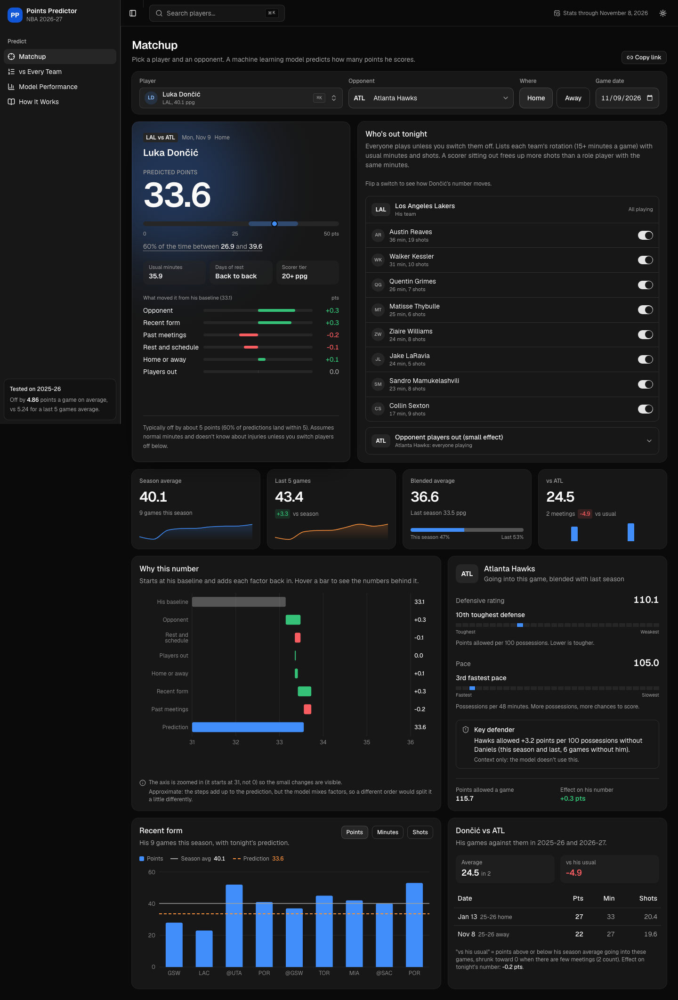

# NBA Player Points Predictor

Pick an NBA player, an opponent and who's sitting out tonight, and get a prediction of how many points he scores.

This is Ethan Okelberry's final project for Intro to AI at CSUSM (Fall 2026). It's a supervised regression on tabular data: one row per player per game, 33 features built only from games before the one being predicted, and the target is points scored.



## Results

The test season is 2025-26 (19,832 player games). The model never saw it during training or tuning, and it was scored once at the end.

| approach | test MAE (points) |
|---|---|
| **Final model: 0.6 x HistGradientBoosting + 0.4 x Huber regression** | **4.86** |
| HistGradientBoosting, tuned | 4.86 |
| Huber regression, tuned | 4.87 |
| Ridge, tuned | 4.90 |
| Baseline: blended season average | 5.05 |
| Baseline: last 5 games average | 5.24 |

- It beats the "last 5 games" rule by 0.38 points per game (about 7%), and the ranking matches cross-validation.
- 39% of predictions land within 3 points, 60% within 5, and 10% miss by 10 or more.
- **Live tracker, 2026-27 season:** the deployed model has never seen these games. Through Nov 8, 2026 (2,383 games) it scores an MAE of 4.86 vs 5.34 for the last-5 rule. The site's Model Performance page updates this every time the data is refreshed.
- Things that didn't help: a two-stage model (predict minutes, then points), extra interaction features, splines, recency weighting. Details are in `notebooks/02_models.ipynb` and the site's How It Works page.

## How it works

```
Next.js site (web/, Vercel)
        |  HTTP / JSON
        v
FastAPI backend (api/, Render, Docker)
        |
        v
src/pregame.py    builds tonight's 33 features with the SAME code used for training (src/build_features.py)
        |
        v
src/predict.py    models/deploy_model.joblib (0.6 HistGB + 0.4 Huber, trained 2018-19 to 2025-26)
```

- Data comes from [nba_api](https://github.com/swar/nba_api) (stats.nba.com game logs, 2017-18 to now).
- Training and the site share one feature function, so site predictions can't drift from what the model learned. `src/check_pregame.py` rebuilds 25 real games through the site's code path and checks every feature matches the training table exactly.
- `src/check_features.py` is the leak test: it deletes every game after a cutoff date, rebuilds, and checks that no earlier feature changed.
- `app/streamlit_app.py` is a simpler backup site that uses the same code.

## Project layout

```
data/raw/          raw game logs from nba_api (not in git, rebuild with src/pull_data.py)
data/processed/    features.csv (not in git, rebuild with src/build_features.py)
data/site/         the small slice of data the API needs (~0.6 MB, in git)
notebooks/         01_eda, 01b_attribute_combinations, 02_models (the class workflow)
src/               data pull, features, checks, prediction code
models/            final_model.joblib (test-set model), deploy_model.joblib (used by the site)
results/           CV and test tables, best hyperparameters
figures/           charts from the notebooks
api/               FastAPI backend + Dockerfile + tests
web/               Next.js front end
app/               Streamlit backup site
docs/              project proposal and assignment
```

## Run it locally

You need Python 3.10+ (3.12 recommended; macOS's built-in 3.9 hangs on stats.nba.com) and Node 20+.

**1. Python setup (once)**

```bash
cd nba-points
python3.12 -m venv .venv
source .venv/bin/activate
pip install -r requirements.txt -r api/requirements-dev.txt
```

`scikit-learn` must be 1.9.1 (pinned in `api/requirements.txt`). The saved models won't load on a different version.

**2. API** (terminal 1, project root)

```bash
source .venv/bin/activate
uvicorn api.main:app --reload
```

Interactive docs at http://localhost:8000/docs. Tests: `pytest api/tests -s`.

**3. Website** (terminal 2)

```bash
cd web
npm install          # first time only
npm run dev
```

Open http://localhost:3000. It talks to http://localhost:8000 by default (see `web/.env.example`).
Checks: `npm run lint`, `npm run build`, and `npm run screenshots` (needs both servers running; loads every page on desktop and phone, light and dark, and runs an accessibility check).

**Streamlit backup (optional):** `streamlit run app/streamlit_app.py` opens http://localhost:8501.

**Rebuilding everything from scratch (optional).** The repo already has everything the site needs. To redo the full pipeline:

```bash
python src/pull_data.py        # ~10 seasons of game logs into data/raw/ (slow on purpose, stats.nba.com throttles)
python src/build_features.py   # data/processed/features.csv
python src/check_features.py   # leak test
```

Then run the notebooks in order: `01_eda`, `01b_attribute_combinations`, `02_models`.

## Refresh the data

stats.nba.com blocks cloud servers, so new games get pulled on the laptop and pushed to GitHub:

```bash
./refresh.sh
git add data/site
git commit -m "refresh data"
git push
```

`refresh.sh` pulls the latest games, rebuilds the features and `data/site/`, updates the live tracker, and runs the match test. The model itself doesn't get retrained mid-season; only the stats it reads change. Pushing redeploys the hosted API and site. Deploy steps are in [DEPLOY.md](DEPLOY.md).

## Limitations

- No pregame injury or lineup news. The site lets you switch off players who are out, but it doesn't know on its own.
- It predicts the typical night (predictions range about 2 to 35). It can't see a 50-point game coming.
- Foul trouble, blowouts, and coaching decisions are mostly random from the model's point of view.

## AI use

AI tools (Claude) were used for code, debugging, drafting, and analysis, as encouraged in the course. They're disclosed in the project submission.
